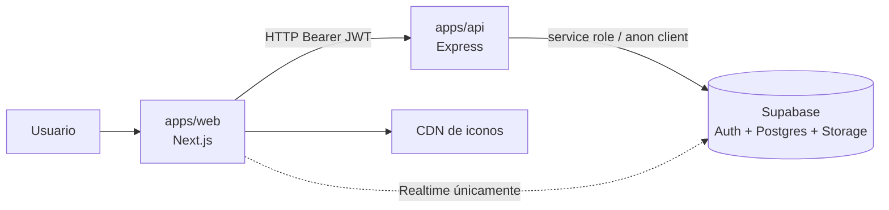
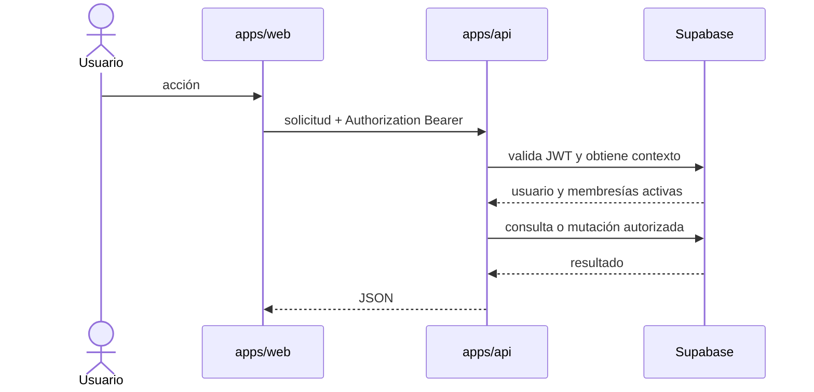

# Arquitectura general

## Vista de contexto

El monorepo usa npm workspaces y Turborepo. `apps/web` y `apps/docs` son aplicaciones Next.js; `apps/api` es un proceso Express TypeScript. Los paquetes compartidos contienen configuración y componentes de ejemplo.

## Flujo de una operación

La API usa una clave privilegiada para datos; por eso la autorización de aplicación es crítica. El navegador crea además un cliente Supabase para Realtime y establece el token explícitamente solo en chat, no en feed/comentarios.

## Límites comprobados

- No hay esquema SQL, migraciones, seeds ni políticas RLS en el repositorio.
- No hay configuración de CI/CD o infraestructura versionada.
- `apps/docs` sigue siendo una plantilla y no sirve estos Markdown.
- Los contratos son tipos y controladores TypeScript, sin OpenAPI.
- Las escrituras compuestas no usan transacciones visibles en el repositorio.

## Dependencias entre módulos

- `apps/web/app` depende de componentes, `stores/auth.store.ts` y clientes de `lib/api`.
- `apps/web/lib/api` encapsula HTTP hacia la API; `lib/supabase.ts` se reserva para Realtime.
- `apps/api/server.ts` monta routers; éstos llaman controladores y, para posts/chat, servicios/utilidades.
- `apps/api/lib/supabase.ts` expone clientes anon y service-role.
- `packages/ui` no es el sistema de componentes principal de la interfaz revisada.

## Riesgos arquitectónicos

1. El modelo de datos efectivo está fuera del control de versiones.
2. El service role elude RLS; un error de autorización del backend puede cruzar eventos.
3. El frontend y backend no comparten tipos de contrato.
4. Turborepo no ejecuta build, lint o typecheck de la API porque ese paquete no define esos scripts.
5. La autorización administrativa global no coincide con el aislamiento histórico por evento.

Las decisiones que sí tienen evidencia se registran en [ADR](../06-decisiones/README.md).
