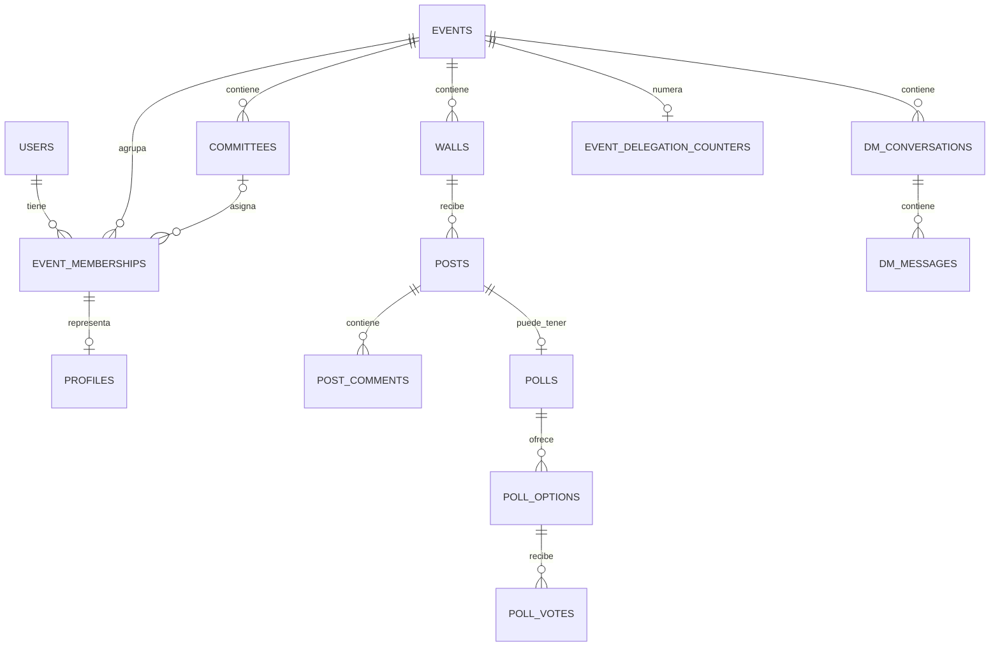

# Base de datos

## Qué está versionado

| Fuente | Contenido y alcance |
|---|---|
| [Snapshot de public](../../supabase/schema.sql) | Columnas y resumen de enums y constraints. Extraído el 26 de octubre de 2026 y actualizado con la 001. Es una referencia, sin DDL base reproducible, políticas ni volcado completo de índices y funciones. |
| [Migración 001](../../supabase/migrations/001_alias_codigo_fijados_archivos.sql) | Alias, código de delegación, fijado, atribución de borrado, adjuntos e índices únicos parciales para muros y código de delegación. Su encabezado registra aplicación el 5 de noviembre de 2026. |
| [Migración 002](../../supabase/migrations/002_codigo_delegacion.sql) | Contador, RPC, trigger de inmutabilidad y asignación a registros existentes. Requiere la 001. Su encabezado indica que estaba pendiente de aplicación. |
| [Migración 003](../../supabase/migrations/003_adjuntos_un_por_post.sql) | Un adjunto por post, intentos de subida (`attachment_uploads`) y retención de adjuntos. Requiere la 001, no la 002. Redactada el 20 de noviembre de 2026; **no aplicada**. El snapshot no la refleja. |

Esas notas de aplicación son históricas. Esta revisión no consultó Supabase. Las migraciones son incrementales y requieren una base previa. El SQL de adjuntos, contador e intentos de subida habilita RLS en esas tablas. Las políticas efectivas de las tablas principales, Storage y la publicación Realtime quedan por confirmar.

## Relaciones del dominio

Los campos y usos están en [modelos de datos](../03-referencia/modelos-de-datos.md). El snapshot resume unicidad de códigos de participante por evento y de votos por encuesta y membresía. La migración 001 limita a uno cada tipo de muro general/anuncios vigente por evento y un muro vigente por comité. Estos índices limitan duplicados, pero no crean muros.

## Validaciones pendientes

La [compatibilidad entre API y esquema](../07-auditoria/discrepancias.md#d-05--compatibilidad-entre-api-y-esquema) debe comprobarse en una base aislada, en particular el rol al crear un evento y las columnas/RPC usadas por participantes y perfiles. Verificar también triggers existentes, aprovisionamiento de muros iniciales, reutilización de conversaciones bajo concurrencia y acceso efectivo a canales y avatares.
