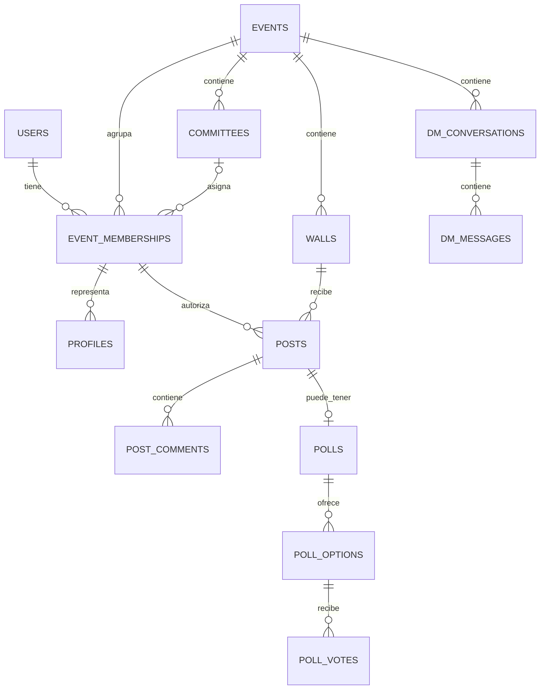

# Base de datos

## Alcance de esta referencia

No hay migraciones, DDL, seeds ni políticas RLS versionadas. Este documento es un modelo **inferido de las consultas del código**, no una descripción certificada del esquema desplegado.

## Entidades observadas

Tablas referenciadas: `users`, `events`, `event_memberships`, `committees`, `walls`, `profiles`, `posts`, `post_committee_tags`, `post_comments`, `polls`, `poll_options`, `poll_votes`, `dm_conversations`, `dm_messages`, `audit_logs` y `auth_attempts`.

## Relaciones funcionales

- `event_memberships` vincula usuario, evento, rol, estado, código y opcionalmente comité.
- `profiles` expone datos públicos asociados a membresía.
- `walls` pertenece al evento y puede referir un comité.
- `posts` pertenece a muro y membresía autora; una encuesta agrega `polls`, opciones y votos.
- `dm_conversations` y `dm_messages` se restringen funcionalmente al evento.
- `audit_logs` y `auth_attempts` reciben trazas best-effort.

## Restricciones esperadas pero no verificables

- `participant_code` único por evento.
- Un voto vigente por encuesta y membresía.
- Una conversación uno a uno única por pareja/evento.
- Claves foráneas y cascadas coherentes.
- Enumeraciones para estados de evento, cuenta, contenido y mensaje.
- Políticas RLS para tablas y canales Realtime.
- Buckets y políticas de Storage.

## Anomalías observadas en el contrato

- El código asigna `AUTHOR` o `ADMIN` a `posts.deleted_by_membership_id`, aunque el nombre sugiere un UUID de membresía.
- El borrado de DM prueba varios valores posibles de estado mediante `DM_DELETED_MESSAGE_STATUS`, señal de desalineación de enum entre entornos.
- La creación de evento, encuesta y otras operaciones relacionadas no es atómica desde la API.

## Acción previa a cambios de datos

Obtener un dump de esquema sin datos, políticas RLS, índices, triggers, funciones, enums y configuración de Storage. Compararlo con [modelos de datos](../03-referencia/modelos-de-datos.md) antes de diseñar migraciones.
