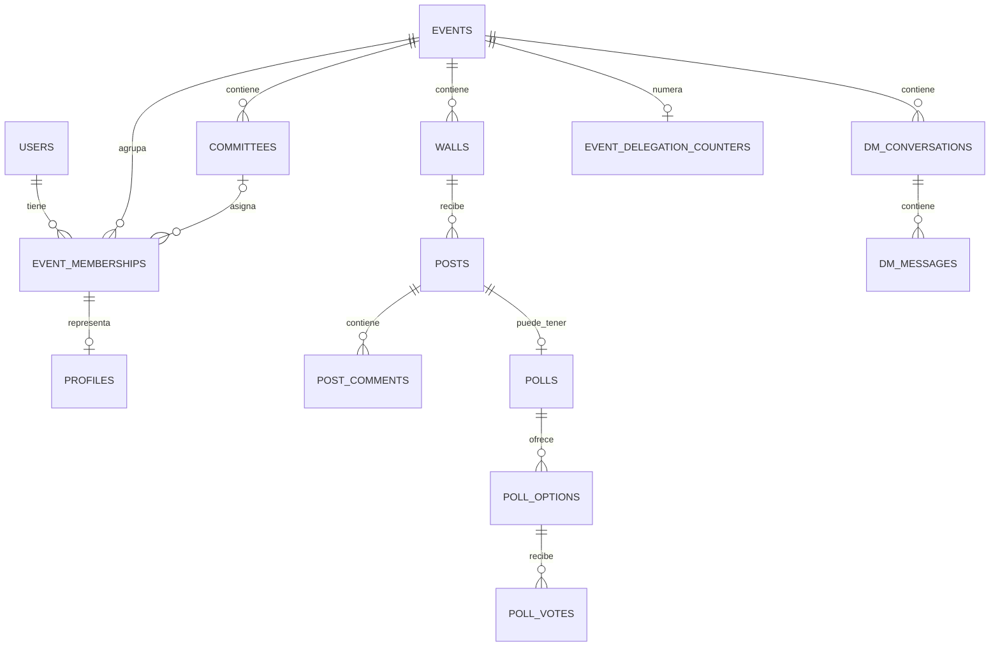

# Base de datos

## Qué está versionado

| Fuente | Contenido y alcance |
|---|---|
| [Snapshot de public](../../supabase/schema.sql) | Columnas y resumen de enums y constraints. Extraído el 26 de octubre de 2026 y actualizado con la 001. Es una referencia, sin DDL base reproducible, políticas ni volcado completo de índices y funciones. |
| [Migración 001](../../supabase/migrations/001_alias_codigo_fijados_archivos.sql) | Alias, código de delegación, fijado, atribución de borrado, adjuntos e índices únicos parciales para muros y código de delegación. Su encabezado registra aplicación el 5 de noviembre de 2026. |
| [Migración 002](../../supabase/migrations/002_codigo_delegacion.sql) | Contador, RPC, trigger de inmutabilidad y asignación a registros existentes. Requiere la 001. Aplicada el 21 de noviembre de 2026 desde el SQL Editor y verificada con consultas de solo lectura: contadores por evento, RLS que niega al rol anónimo, todas las membresías vigentes con código, sin duplicados ni formatos inesperados. |
| [Migración 003](../../supabase/migrations/003_adjuntos_un_por_post.sql) | Un adjunto por post, intentos de subida (`attachment_uploads`) y retención de adjuntos. Requiere la 001, no la 002. Aplicada el 20 de noviembre de 2026 desde el SQL Editor y verificada con consultas de solo lectura (tabla, `retention_hold`, restricción de tipo y RLS que niega al rol anónimo). El snapshot no la refleja. |
| [Migración 006](../../supabase/migrations/006_reacciones_publicaciones.sql) | Tabla `post_reactions`, una fila por membresía y post, RLS sin acceso directo para `authenticated`/`anon`; las lecturas y escrituras pasan por la API. Su aplicación en producción se reportó, no se verificó en esta revisión. |
| [Migración 010](../../supabase/migrations/010_reacciones_realtime.sql) | Trigger de invalidación Broadcast privada y política de recepción derivada de membresía activa, evento y acceso al muro. Borrador; debe aplicarse antes de desplegar la web que escucha el canal. No modifica filas existentes. |
| [Migración 011](../../supabase/migrations/011_resumen_mensajes_directos.sql) | RPC `get_dm_conversation_summaries` para previews y no leídos de conversaciones DM, más un índice parcial del último mensaje visible. Depende de la columna `dm_messages.read_at` (004); aplicar antes de desplegar la API actualizada. |
| [Migración 012](../../supabase/migrations/012_contexto_auth.sql) | RPC `get_auth_context_by_supabase_auth_user_id` con JOIN explícito de usuario, membresías, eventos y comités. Solo ejecutable por `service_role`; requiere que las tablas base ya existan y aplicarse antes de desplegar la API actualizada. |

Esas notas de aplicación son históricas. Esta revisión no consultó Supabase. Las migraciones son incrementales y requieren una base previa. El SQL de adjuntos, contador e intentos de subida habilita RLS en esas tablas. La política de recepción Broadcast de la 010 es independiente del acceso a `post_reactions`: el socket recibe solo una invalidación vacía, y la API sigue autorizando cada lectura. La 012 no cambia filas ni permisos de sesión; el fallback API solo cubre `PGRST202` mientras PostgREST aún no reconoce la función.

## Relaciones del dominio

Los campos y usos están en [modelos de datos](../03-referencia/modelos-de-datos.md). El snapshot resume unicidad de códigos de participante por evento y de votos por encuesta y membresía. La migración 001 limita a uno cada tipo de muro general/anuncios vigente por evento y un muro vigente por comité. Estos índices limitan duplicados, pero no crean muros.

## Validaciones pendientes

La [compatibilidad entre API y esquema](../07-auditoria/discrepancias.md#d-05--compatibilidad-entre-api-y-esquema) debe comprobarse en una base aislada, en particular el rol al crear un evento y las columnas/RPC usadas por participantes y perfiles. Verificar también triggers existentes, aprovisionamiento de muros iniciales, reutilización de conversaciones bajo concurrencia y acceso efectivo a canales y avatares.
