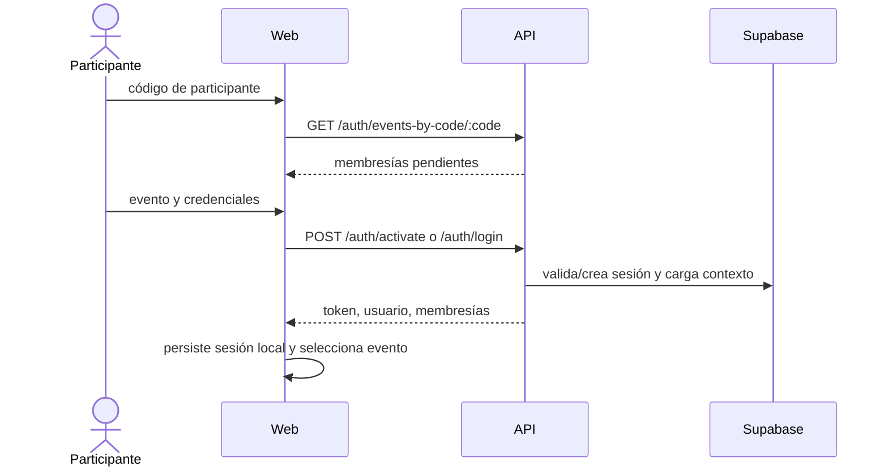

# Autenticación y autorización

## Flujo de activación y acceso

El frontend persiste token y contexto en `localStorage`. El logout borra ese estado, pero no se observó revocación de sesión remota.

## Contexto del servidor

`requireAuth`:

1. extrae el bearer token;
2. llama a Supabase Auth;
3. resuelve el usuario interno;
4. carga solo membresías activas;
5. adjunta el resultado a `req.auth`.

Los controladores seleccionan una membresía usando evento, muro o encabezado. Esta selección dispersa exige revisar cada flujo.

## Administración

El panel web comprueba la membresía activa. La API usa `requireAdmin`, que busca cualquier membresía activa cuyo rol coincida textualmente. No hay rol global formal ni vínculo obligatorio con `event_id` del cuerpo. Véase [roles y permisos](../01-producto/roles-y-permisos.md).

## Riesgos

- Logging de payload de login con posible contraseña en `apps/web/lib/api/auth.ts`.
- Sin rate limiting ni bloqueo visible por intentos.
- `auth_attempts` es best-effort.
- CORS permite un único origen normalizado, pero no sustituye autenticación.
- Ausencia de RLS versionado y uso de service role.
- Persistencia del token en `localStorage`, expuesta ante XSS.

## Reglas para cambios futuros

- No confiar en roles o IDs enviados por el cliente.
- Autorizar siempre contra la membresía del recurso/evento objetivo.
- No registrar contraseñas, tokens o respuestas sensibles.
- Añadir pruebas negativas: sin token, membresía de otro evento, rol insuficiente y cuenta inactiva.
- Documentar por separado una decisión de superadministración global si el negocio la aprueba.
