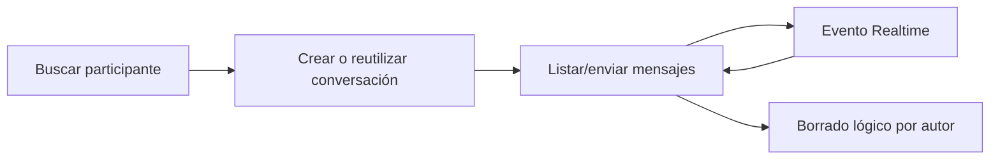

# Flujos funcionales

## Activación e ingreso

1. La persona introduce su código.
2. La web consulta cuentas pendientes por código.
3. Selecciona evento cuando corresponde y activa o inicia sesión.
4. La API devuelve token/contexto con membresías activas.
5. Si hay más de una, la persona selecciona evento; el store conserva la membresía activa.

Limitaciones: no hay recuperación de contraseña; el login registra datos sensibles en consola del navegador; producción no fue probada.

## Lectura y publicación en un muro

1. La ruta `/feed/[muro]` obtiene metadatos y publicaciones por `lib/api`.
2. `GET /posts?muro=...` resuelve muro, evento y membresía.
3. El servicio comprueba acceso y devuelve posts visibles.
4. Para publicar, `POST /posts` valida capacidad; si es encuesta crea post, poll y opciones secuencialmente.
5. Realtime dispara una recarga de la API.

Limitaciones: sin paginación, sin adjuntos, transacción no garantizada y autorización Realtime no verificable.

## Comentarios y encuestas

Los comentarios aceptan un padre, pero no nietos. En anuncios solo administración comenta. Un voto nuevo elimina/reemplaza el anterior mediante varias operaciones; el autor puede cerrar su encuesta. No hay reapertura.

## Perfil

El evento activo viaja en `x-event-id`. El usuario edita nombre/bio/ruta de imagen o sube un avatar base64. Administración puede editar perfiles ajenos con restricciones. Storage se configura como público; no se verificaron sus políticas.

## Mensaje directo

Ambas membresías deben estar activas y pertenecer al mismo evento. No existen grupos, adjuntos, bloqueo ni supervisión.

## Crear evento desde el panel

1. El layout exige que la membresía seleccionada parezca administrativa.
2. `/admin/events/new` valida nombre, slug y fechas en cliente.
3. `POST /admin/events` exige token y cualquier membresía administrativa activa.
4. El controlador crea el evento directamente `ACTIVE` y sus datos auxiliares según el código.
5. La UI vuelve a `/admin/events`, que todavía muestra un marcador sin listado.

## Crear/listar comités desde el panel

El formulario envía `event_id`, nombre, código, descripción y orden a `POST /admin/committees`. El listado reutiliza `GET /events/:eventId/committees`, que sí exige membresía en ese evento. Esto produce capacidades distintas entre crear y leer si el admin pertenece a otro evento.

## Flujos no existentes

No hay recorridos completos para edición/cierre de evento, administración visual de participantes/asignaciones, importación CSV, reportes, sanciones, notificaciones, auditoría consultable o supervisión de DM.
