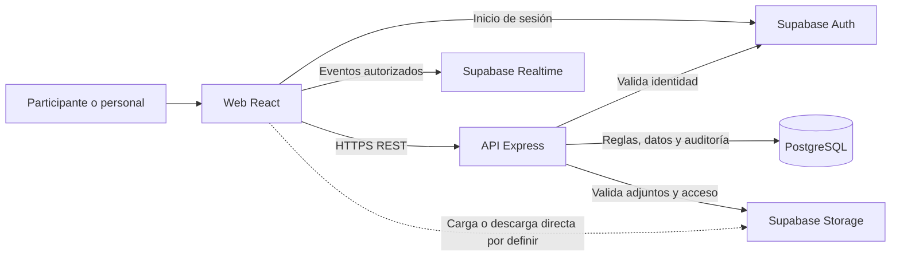

# Arquitectura de referencia y requisitos de calidad

La arquitectura aquí descrita es la **propuesta aceptada dentro de `ENTREGA_MUNET_1/Arquitectura MUNET.pdf`**, no una verificación de código existente. Se apoya en sus ADR-001–004 (pp. 65–71), C4 (pp. 61–65) y NFR (pp. 50–53). `Arquitectura MUNET-2-Microservicios.pdf` conserva un diseño alternativo incompatible; la elección institucional final debe confirmarse (D-01 en [README.md](README.md)).

## Decisión técnica de base

- **Cliente:** aplicación web React; no se requiere app móvil nativa.
- **Backend:** API Node.js con Express y TypeScript, organizada en módulos de identidad/membresías, eventos/comités, foro, DM, moderación, notificaciones, adjuntos y auditoría.
- **Capas del backend:** presentación (rutas, controladores y validación), aplicación (casos de uso), dominio (entidades y reglas) e infraestructura (repositorios y adaptadores). El dominio no depende de Supabase ni de HTTP.
- **Persistencia y servicios:** Supabase PostgreSQL como base relacional, Auth para sesión, Realtime para entrega inmediata y Storage para adjuntos. PostgreSQL es la fuente persistente; Realtime no reemplaza la confirmación de escritura.
- **Despliegue:** Vercel aparece como opción para el frontend y en una evidencia académica de despliegue. Proveedor, dominios, secretos, ambiente y operación de producción siguen sin verificarse.

La API es el punto de control de los casos de uso. Toda ruta valida sesión, estado de cuenta, evento, rol, comité y recurso. Las políticas de base de datos o RLS actúan como defensa adicional, especialmente si el cliente llega directamente a Auth, Realtime o Storage. La forma de integrar `participant_code` con Supabase Auth sin colisiones entre eventos aún debe diseñarse.

## Responsabilidades y datos

| Área | Entidades conceptuales | Invariantes principales |
| --- | --- | --- |
| Organización | Event, Committee, Wall, EventMembership, Profile | Un participante por evento; un comité para participante; un muro por comité y evento. |
| Foro | Post, Comment, Poll, PollOption, PollVote, Attachment | Un muro por post; un adjunto total; un voto por miembro y encuesta; acceso heredado del muro/post. |
| Mensajería | DMConversation, DMMessage | Dos miembros del mismo evento; mensajes persistentes, aislados y eliminables lógicamente. |
| Protección | Report, Incident, Sanction, AuditLog | Estado y responsable de decisiones; auditoría antes de supervisar DM. |
| Operación | Notification, CSVImportBatch | Avisos persistentes; importaciones confirmadas y trazables. |

El diagrama `ENTREGA_MUNET_1/DIAGRAMAS/MUNET_ModeloDeDominio.pdf` contiene estas entidades, pero sus nombres de estado no son totalmente consistentes con el anexo funcional. El esquema físico, claves, índices, transacciones y migraciones quedan para diseño técnico. Como restricciones mínimas, las relaciones deben impedir referencias cruzadas de evento y garantizar unicidad de `(event_id, participant_code)`, `(post_id)` para adjunto y `(poll_id, voter_membership_id)` para voto.

## Atributos de calidad verificables

| ID | Objetivo de fuente | Verificación requerida y estado |
| --- | --- | --- |
| NFR-01 Disponibilidad | ≥99,5 % durante los días del evento. | Monitorizar desde un cliente externo el periodo acordado; definir exclusiones y ventana exacta antes de aceptación. |
| NFR-02 Feed | Listado paginado p95 <400 ms con carga normal. | Prueba de carga con dataset realista, desde petición a respuesta de API; registrar p95 y número de usuarios concurrentes. |
| NFR-03 Escritura de foro | Crear post o comentario p95 <600 ms. | Medir desde petición a persistencia confirmada y respuesta; fallos no se presentan como éxito. |
| NFR-04 DM | La definición de éxito dice p95 <500 ms; la tabla NFR dice p95 <800 ms para persistencia y reflejo al receptor. | Instrumentar ambos hitos, publicar resultados y **resolver D-02 antes de fijar pase/fallo**. |
| NFR-05 Pico | La tabla menciona tráfico 3× con p95 <1200 ms; la propuesta habla de 250 usuarios iniciales y hasta 300 de pico. | Definir carga base, mezcla de operaciones y duración; probar al menos el escenario de 300 usuarios como hipótesis conservadora, sin afirmar que equivale a 3×. |
| NFR-06 Acceso | Cero accesos no autorizados a recursos de otro evento, comité, rol o DM; intentos bloqueados registrados. | Suite de autorización por API, Storage y Realtime con IDs manipulados; ningún caso de la matriz de pruebas debe filtrar datos. |
| NFR-07 Auditoría | 100 % de acciones críticas dejan registro. | Ejercitar cada acción de CA-24 y verificar entrada completa. La supervisión de DM falla cerrada si no se registra. |
| NFR-08 Confiabilidad | Cero pérdida **silenciosa** de posts y mensajes. | Simular error de BD o red; la UI no confirma éxito y muestra error recuperable con identificador de solicitud. Reconciliar escritura persistida y vista. |
| NFR-09 Recuperación | Restauración tras caída <60 min; pérdida de datos «<15 min» en tabla. | Interpretación provisional: RTO <60 min y RPO <15 min. Confirmar significado y probar restauración de copia antes de evento. |
| NFR-10 Observabilidad | 100 % de peticiones API registran fecha, `request_id`, usuario, evento, endpoint y estado. | Revisar muestra completa de peticiones y correlación de errores; medir latencia por ruta y alertar ante 5xx, p95 fuera de objetivo e intentos de acceso indebido. |

`p95` significa que el 95 % de las observaciones de la ventana acordada queda por debajo del umbral. La prueba debe declarar dataset, concurrencia, red, punto de medición y periodo; esos parámetros no están fijados en las fuentes. Los valores anteriores son objetivos documentados, no resultados medidos.

## Seguridad y operación

1. El servidor autoriza cada acción con rol, estado de cuenta, `event_id`, comité y propiedad del recurso. No se confía en un `event_id` enviado por el cliente sin cotejarlo con la membresía.
2. Los recursos de Storage heredan los permisos del post; un enlace directo no debe saltarse el control. Las suscripciones Realtime tampoco deben revelar eventos ajenos.
3. La supervisión de DM es lectura excepcional, con motivo y auditoría previa; la presencia de participantes menores hace imprescindible aprobar el protocolo de acceso y la retención antes de operar.
4. Las acciones críticas y operaciones de varias tablas que dependan entre sí deben ejecutarse con consistencia transaccional o resultado recuperable; la UI confirma éxito solo después de persistencia.
5. Logs operativos deben permitir correlación mediante `request_id`, sin registrar contraseñas, tokens o cuerpos de DM como campos de diagnóstico. Esta última precaución es una recomendación de diseño para cumplir la confidencialidad prevista.
6. La fuente propone rate limiting para login, posts y DM, pruebas de aislamiento entre eventos/comités y un plan manual de contingencia para anuncios si la plataforma cae.

## Secuencia de entrega propuesta en la fuente

- **MVP:** eventos y aislamiento, activación y acceso, muros, posts/comentarios, DM 1:1, reporte inicial y auditoría mínima.
- **Operación:** resolver reportes, moderar, sancionar y completar herramientas de administración.
- **Calidad:** pruebas de seguridad y resiliencia, observabilidad, documentación API y evidencia de objetivos NFR.

Encuestas, adjuntos y notificaciones aparecen en el anexo funcional, pero no están colocados inequívocamente en esas iteraciones. Su asignación de versión es una decisión de planificación pendiente; no se eliminan del catálogo de requerimientos.
